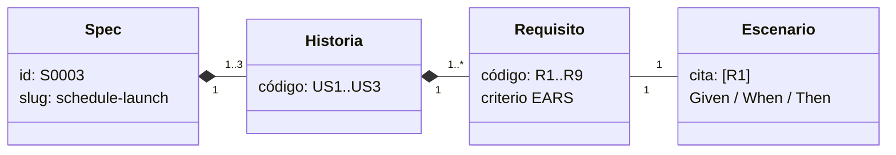
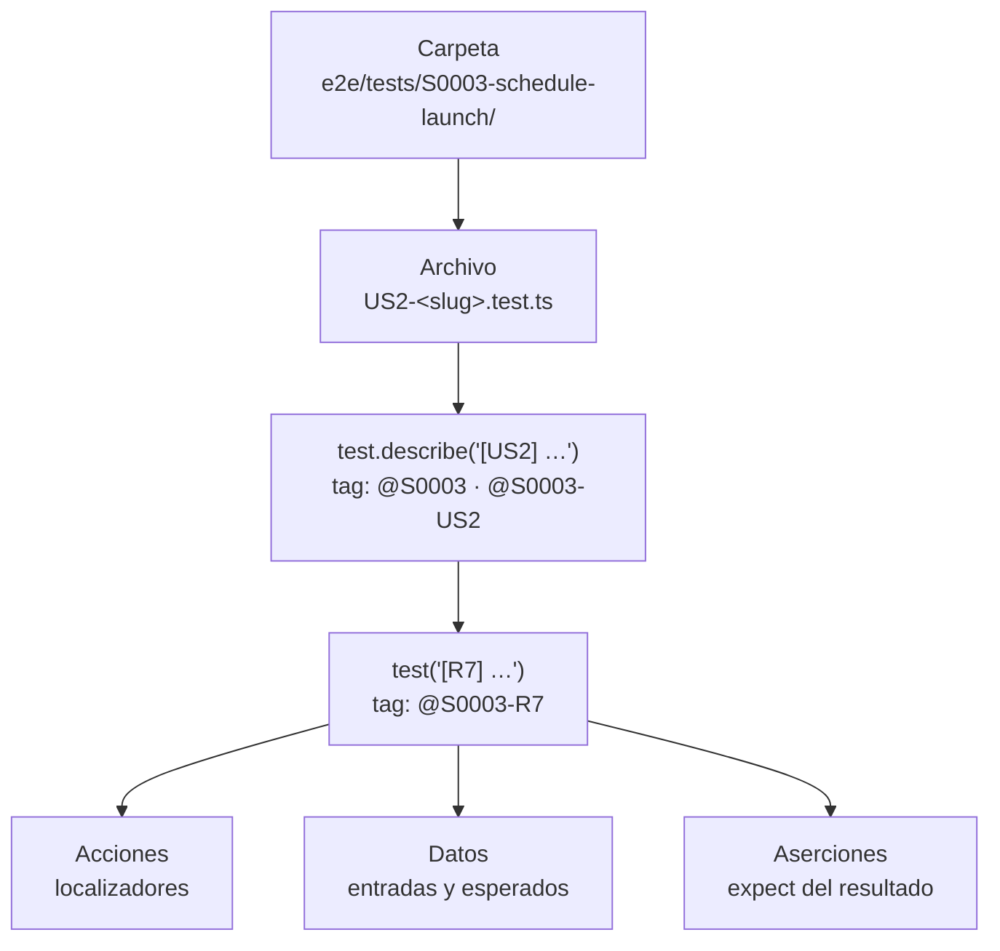
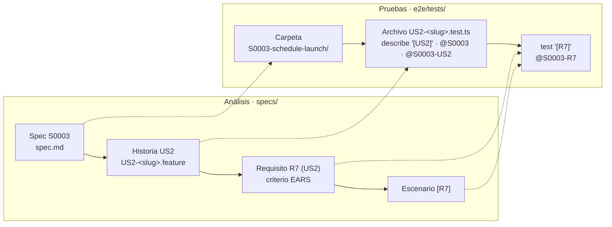

# M02-L02 · Taxonomía: de la spec a la prueba

Documento de apoyo de la lección [Organización de specs](M02-L02-I0-organizacion-specs.md).

Este documento ordena los nombres que usamos en el análisis y en las pruebas. Primero describe la especificación funcional. Después describe la implementación de las pruebas con Playwright. Al final relaciona los dos niveles.

El objetivo es la trazabilidad: desde un requisito, llegar a su prueba; desde una prueba que falla, llegar al requisito que no se cumple.

---

## 1. Especificación funcional

La especificación funcional describe **qué** debe hacer la aplicación. No dice cómo se prueba.



### Spec

Una spec describe una funcionalidad completa. En el ejemplo del curso, programar lanzamientos de cohetes.

- Tiene un id único, como `S0003`, y un slug, como `schedule-launch`.
- El id y el slug nombran su carpeta: `specs/S0003-schedule-launch/`.
- El documento principal es `spec.md`. Contiene el problema, las historias, las reglas, la solución, los criterios EARS y lo que queda fuera de alcance.

### Historia

Una historia de usuario describe lo que necesita un usuario. Una spec tiene de 1 a 3 historias.

- Cada historia tiene un código: `US1`, `US2`, `US3`.
- Cada historia se escribe en un archivo `.feature` de Gherkin, dentro de la carpeta de la spec. El nombre empieza por su código: `US1-<slug>.feature`.
- `Feature` es la palabra clave de Gherkin para ese archivo. No es otro nivel del análisis: en este proyecto, un `Feature` contiene una historia.

### Requisito

Un requisito es un criterio de verificación escrito con EARS. Una spec tiene de 1 a 9 requisitos en total.

- Cada requisito tiene un código único en la spec: `R1`, `R2`, …
- Cada requisito pertenece a una sola historia y la nombra: `R7 (US2)`.
- Cada historia tiene al menos un requisito.
- Los códigos siguen el orden de las historias: los requisitos de `US1` empiezan en `R1`.

### Escenario

Un escenario es el ejemplo concreto que demuestra un requisito.

- Hay un escenario por requisito, en el `.feature` de su historia.
- El título del escenario cita el código del requisito: `[R7]`.
- Si el requisito necesita varios ejemplos, el escenario es un `Scenario Outline` con una tabla `Examples`. Por ejemplo, `[R8]` comprueba dos casos: sin token y con un token no válido.
- Los pasos `Given`, `When` y `Then` describen el estado inicial, la acción y el resultado esperado.

### Lo que no tiene código

El problema, las reglas RuleSpeak, la solución y el fuera de alcance dan contexto. No tienen código y no generan una prueba.

Si una regla se debe comprobar, escríbela también como criterio EARS. Por ejemplo, «un cohete no puede tener dos lanzamientos a la vez» solo tiene prueba si un requisito `R` la recoge.

### Ejemplo de archivos

```text
specs/S0003-schedule-launch/
├── spec.md                  problema, US1..US3, reglas, R1..R9 con su historia
├── US1-<slug>.feature      Feature de US1 · un Scenario por cada R de US1
└── US2-<slug>.feature      Feature de US2 · un Scenario por cada R de US2
```

```gherkin
Feature: [US2] <nombre de la historia>

  Scenario: [R7] <nombre del escenario>
    Given <estado inicial>
    When <acción del usuario>
    Then <resultado que pide R7>
```

---

## 2. Implementación de las pruebas

La implementación describe **cómo** se comprueba cada requisito con Playwright.



### Carpeta

Una carpeta por spec, con el mismo nombre que en `specs/`: `e2e/tests/S0003-schedule-launch/`.

### Archivo y `test.describe`

Un archivo `.test.ts` por historia, con el mismo nombre que su `.feature`: `US2-<slug>.feature` → `US2-<slug>.test.ts`.

Dentro hay un `test.describe` por historia. Su título empieza por el código de la historia, `[US2]`. Lleva dos etiquetas: la de la spec, `@S0003`, y la de la historia, `@S0003-US2`. Los `test` del `describe` heredan las dos etiquetas.

### `test`

Un `test` por escenario, directamente dentro del `describe` de su historia. Su título empieza por el código del requisito, `[R7]`. Lleva la etiqueta `@S0003-R7`, que une el id de la spec y el código del requisito.

Si el escenario es un `Scenario Outline`, hay un `test` por cada fila de `Examples`. Todos llevan la misma etiqueta, por ejemplo `@S0003-R8`, y un título distinto.

No hay un `describe` por requisito. Ese `describe` tendría un solo `test`, o los `test` de un `Scenario Outline`, que la etiqueta ya agrupa al ejecutar.

Las etiquetas llevan siempre el id de la spec delante. `US2` y `R7` se repiten en todas las specs; `@S0003-US2` y `@S0003-R7`, no.

### Dentro del `test`

- **Acciones.** Usan localizadores para encontrar los elementos que ve el usuario: `getByRole`, `getByLabel`, `getByText`. Lo viste en L01. En L03 se agrupan en Page Objects.
- **Datos.** Son las entradas y los resultados esperados. En L04 se separan de la prueba.
- **Aserciones.** Son los `expect` que comprueban el resultado del requisito. Lo viste en L01.

```ts
test.describe('[US2] <nombre de la historia>', {
  tag: ['@S0003', '@S0003-US2'],
}, () => {
  test('[R7] <nombre del escenario>', {
    tag: '@S0003-R7',
  }, async ({ page }) => {
    // acciones con localizadores
    // expect del resultado que pide R7
  })

  // Scenario Outline: un test por fila de Examples
  for (const token of ['no token', 'a token not valid']) {
    test(`[R8] <nombre del escenario> · ${token}`, {
      tag: '@S0003-R8',
    }, async ({ page }) => { … })
  }
})
```

---

## 3. La relación entre los dos niveles

Las pruebas repiten los códigos del análisis. **No crean códigos nuevos.** Un requisito, su escenario y su `test` comparten el mismo código.



| Análisis | Cuántos | Prueba | Cómo ejecutarlo |
| --- | --- | --- | --- |
| Spec `S0003` · `spec.md` | 1 | Carpeta `S0003-schedule-launch/` | `--grep '@S0003'` |
| Historia `US2` · `US2-<slug>.feature` | 1–3 por spec | `US2-<slug>.test.ts` y `test.describe('[US2] …')` con `@S0003-US2` | `--grep '@S0003-US2'` |
| Requisito `R7 (US2)` | 1–9 por spec | Etiqueta `@S0003-R7` | `--grep '@S0003-R7'` |
| Escenario `[R7]` | 1 por requisito | `test('[R7] …')`; con `Scenario Outline`, un `test` por fila de `Examples` | La misma etiqueta |
| Pasos `Given/When/Then` | Varios por escenario | Acciones, datos y `expect` | — |

### Spec y test: un nombre para cada cosa

Playwright busca por defecto los archivos que terminan en `.spec.ts` o `.test.ts`. Hasta L01 las pruebas usaban `.spec.ts`. Ese sufijo repite la palabra «spec» con otro significado. En L02 las pruebas pasan a `.test.ts`:

| Archivo | Nivel | Qué contiene |
| --- | --- | --- |
| `specs/S0003-schedule-launch/spec.md` | Análisis | La especificación funcional: qué debe hacer la aplicación. |
| `e2e/tests/S0003-schedule-launch/US2-<slug>.test.ts` | Pruebas | El código que comprueba una historia. |

La aplicación ya usa `.test.ts` en sus pruebas unitarias. Así, en todo el proyecto:

- «Spec» es la especificación funcional, con su id `S0003`.
- Un archivo `.test.ts` es un archivo de prueba. En `e2e/tests/` contiene las pruebas de una historia.
- La carpeta `S0003-schedule-launch/` tiene el mismo nombre en `specs/` y en `e2e/tests/`. Une una especificación con sus archivos de prueba.

El cambio no necesita configuración: `testDir` sigue en `./tests`. Los generadores de Playwright crean `.spec.ts` por defecto. Por eso la skill fija el sufijo `.test.ts`.

### Seguir la traza

Si cambia un requisito:

1. Busca su código en `spec.md`, por ejemplo `R7 (US2)`.
2. Abre `US2-<slug>.feature` y busca el escenario `[R7]`.
3. Abre `US2-<slug>.test.ts` y busca los `test` con `@S0003-R7`.

Si falla una prueba:

1. Lee la etiqueta del `test` en el informe, por ejemplo `@S0003-R7`.
2. Busca `R7` en `spec.md`. El criterio indica su historia, `US2`.
3. Compara el resultado de la prueba con el criterio EARS. Decide si falla la aplicación o la prueba.

### Ejecutar por nivel

Desde `e2e/`:

```powershell
# Toda la spec
npx playwright test --grep '@S0003'

# Una historia
npx playwright test --grep '@S0003-US2'

# Un requisito
npx playwright test --grep '@S0003-R7'
```

Los tres niveles se seleccionan con etiquetas. La ruta del archivo también selecciona una historia: `npx playwright test S0003-schedule-launch/US2`.

`--grep` busca texto en el título y las etiquetas. `@S0003` selecciona también `@S0003-US2` y `@S0003-R7`, y es lo que queremos: toda la spec. Como una spec tiene como máximo 9 requisitos, `@S0003-R1` no puede coincidir con un `@S0003-R10`.

[Etiquetas en Playwright](https://playwright.dev/docs/test-annotations) · [Gherkin](https://cucumber.io/docs/gherkin/reference/)
