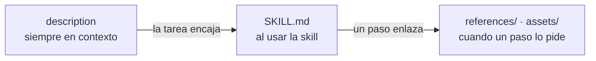
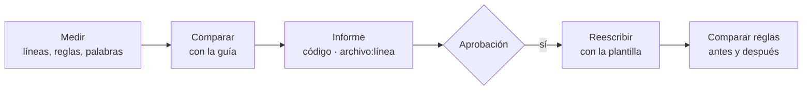

# M02-L05 · Guía de skills

Documento de apoyo de la lección [Revisar skills de la spec a la suite](M02-L05-I0-revisar-skills-de-la-spec-a-la-suite.pdf).

Este documento explica cómo debe ser una skill. Primero describe sus partes. Después da un esquema, unos límites y una lista de lo que se debe y lo que no se debe hacer. Al final explica cómo revisar una skill.

La idea principal: **una skill es código**. El agente la ejecuta cada vez que la usas. Si la skill tiene un error, todas las pruebas que genera tienen ese error. Por eso una skill necesita un estándar y una revisión, como el código de la aplicación.

---

## 1. Las partes de una skill

Una skill es una carpeta en `.agents/skills/`. Solo `SKILL.md` es obligatorio.

```text
.agents/skills/implement-e2e-features/
├── SKILL.md                     instrucciones: qué hacer y en qué orden
├── references/                  reglas detalladas y ejemplos
│   └── e2e-principles.md
└── assets/                      plantillas
```

El agente no lee todo a la vez. Lee cada parte solo cuando la necesita:



Esto explica dos límites de la sección 3:

- La `description` está siempre en el contexto. Si es larga, ocupa espacio en todas las conversaciones.
- `SKILL.md` se lee entero. Lo que no es necesario en cada uso va a `references/` o a `assets/`.

---

## 2. Esquema

Todas las skills tienen las mismas secciones, en el mismo orden. Así encuentras cada cosa en el mismo lugar.

| Código | Sección | Contenido |
| --- | --- | --- |
| O1 | Front matter | `name` (verbo-objeto) y `description` (qué hace y cuándo se usa) |
| O2 | Propósito | El título y una o dos frases |
| O3 | Input | Qué lee y qué pide al usuario |
| O4 | Steps | Una lista numerada de acciones |
| O5 | Rules | Lo que se debe y lo que no se debe hacer. Puede enlazar a `references/` |
| O6 | Output | Qué muestra, qué guarda y cómo verifica el resultado |

La plantilla está en `review-skills/assets/skill.template.md`:

```markdown
---
name: <verb-object>
description: <What the skill does>. Use it when <situation>, or when the user invokes /<verb-object>.
---

# <Verb> <object>

## Input
## Steps
## Rules
## Output
```

Las skills y sus archivos se escriben en inglés y en estilo ASD-STE100. Los prompts y las explicaciones se escriben en español.

---

## 3. Límites

| Código | Elemento | Máximo |
| --- | --- | --- |
| L1 | Líneas de `SKILL.md` | 100 |
| L2 | Reglas en una sección | 10 |
| L3 | Líneas de un ejemplo de código | 10 |
| L4 | Palabras de `description` | 50 |

Un límite es un máximo, **no un objetivo**. No hay que llenar la skill hasta la línea 100. Si una skill crece, saca contenido a otros archivos:

- Reglas detalladas y ejemplos → `references/`.
- Plantillas → `assets/`.

Las cifras son redondas para recordarlas fácilmente. Úsalas también en tus proyectos.

---

## 4. Hacer y no hacer

Cada regla tiene un código. Un informe de revisión cita el código, como una prueba cita su requisito `[R7]`.

### Hacer

| Código | Regla | Ejemplo |
| --- | --- | --- |
| D1 | Una tarea en cada skill | `define-spec` escribe la spec. No la revisa también. |
| D2 | Inglés y estilo ASD-STE100 | Frases cortas, voz activa, una instrucción en cada frase. |
| D3 | Reglas que se pueden verificar | Mal: «Write good tests». Bien: «Put `await` before each action». |
| D4 | Primero lo básico | Localizadores y aserciones (L01) antes que Page Objects (L03). |
| D5 | Cada regla en un solo lugar | Los principios e2e están en un archivo. Las otras skills lo enlazan. |

### No hacer

| Código | Regla | Ejemplo |
| --- | --- | --- |
| N1 | No repetir `AGENTS.md` | «Ask one closed question» ya está en `AGENTS.md`. |
| N2 | No escribir la historia de la skill | Mal: «In L03 we added Page Objects». |
| N3 | No depender de «the other sections» | Escribe la regla o enlaza su archivo. |
| N4 | No añadir lo que el agente ya hace | Cada regla ocupa contexto. Escribe solo lo que cambia el resultado. |

### Dónde va cada regla

| Tipo de regla | Lugar | Ejemplo |
| --- | --- | --- |
| General del proyecto | `AGENTS.md` | Cada prueba es independiente y usa datos únicos. |
| De una tarea | `SKILL.md` | Escribir un `.feature` para cada historia. |
| Detallada o compartida | `references/` de la skill que escribe el resultado | `implement-e2e-features/references/e2e-principles.md` |
| Plantilla | `assets/` | `define-spec/assets/spec.template.md` |

---

## 5. Revisar una skill

Las skills de este curso nacieron de un prompt y crecieron con más prompts. Cada lección añadió reglas al final. Después de cuatro lecciones:

| Problema | Ejemplo real | Código |
| --- | --- | --- |
| Crecimiento por capas | `implement-e2e-features` tenía 108 líneas. Lo básico estaba al final. | L1, D4 |
| Esquema distinto | «Collect the input» / «Read the context»; «Save» / «Finish». | O1–O6 |
| Repeticiones | «Ask one closed question» en 3 skills y en `AGENTS.md`. | N1, D5 |
| Dos tareas | `define-spec` escribía y revisaba. | D1 |
| Dependencias | «The rules in the other sections also apply…» | N3 |

### El ciclo de revisión

`/review-skills` revisa las skills como un revisor revisa código:



1. **Mide** cada skill: líneas, reglas en cada sección y palabras de la `description`.
2. **Compara** con cada regla de la guía.
3. **Muestra un informe** con el código, el archivo y la línea de cada problema. Después para.
4. **Reescribe** solo después de tu aprobación.
5. **Compara las reglas** antes y después.

### La comparación de reglas

Un refactor no cambia el comportamiento. En una skill, el comportamiento son sus reglas. Cada regla antigua tiene uno de estos estados:

| Estado | Significado |
| --- | --- |
| Movida | Está en otro archivo, por ejemplo en `references/`. |
| Mantenida | Está en el mismo archivo. |
| Eliminada | Un código de la guía lo justifica (D1, N1, N2, N4). |

Una regla nueva es un error. Al probar `/review-skills`, el agente perdió dos reglas de los Page Objects y añadió una regla que no existía. Solo la comparación lo detectó. Es la prueba de regresión de una skill.

### Cuándo revisar

- Cuando una skill crece. Por ejemplo, después de añadir las reglas de una lección.
- Cuando escribes una skill nueva.
- Cuando el resultado de una skill no es el esperado.

[Agent Skills](https://agentskills.io/) · [ASD-STE100](https://www.asd-ste100.org/)
