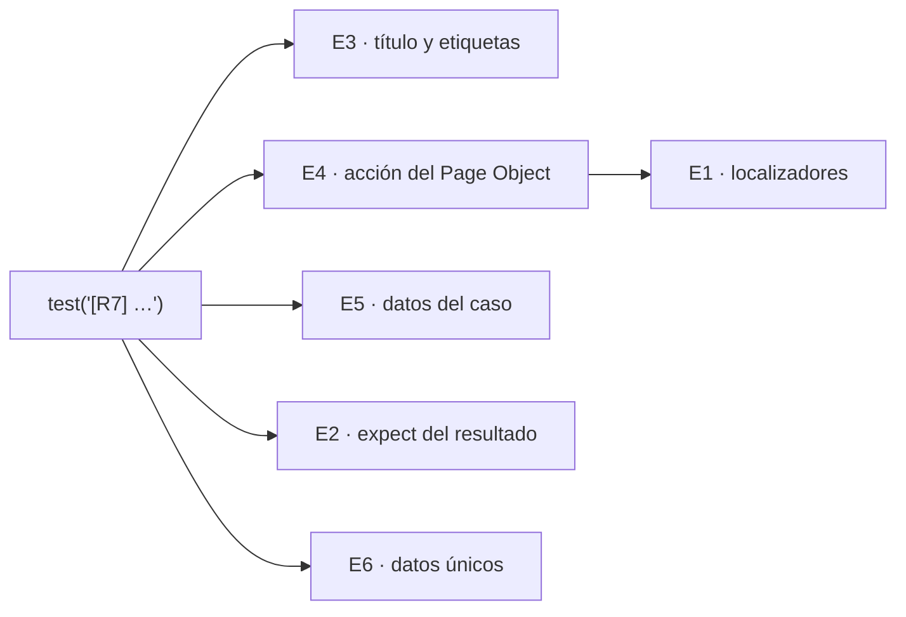

# M02-L05 · Principios e2e con Playwright

Documento de apoyo de la lección [Revisar skills de la spec a la suite](M02-L05-I0-revisar-skills-de-la-spec-a-la-suite.pdf).

Este documento reúne los principios de las pruebas e2e del módulo M02. Cada principio tiene una razón, un ejemplo malo, un ejemplo bueno y su lección de origen. Al final explica cómo se comprueban.

Las skills aplican estos principios al generar las pruebas. `/review-e2e-tests` los comprueba en la suite.

---

## Resumen

| Código | Principio | Lección | Dónde está la regla |
| --- | --- | --- | --- |
| E1 | Localizar como el usuario | L01 | `e2e-principles.md` |
| E2 | Verificar lo observable | L01 | `e2e-principles.md` |
| E3 | Trazar cada prueba a su spec | L02 | `e2e-principles.md` |
| E4 | Usar Page Objects | L03 | `e2e-principles.md` |
| E5 | Separar los datos de prueba | L04 | `e2e-principles.md` |
| E6 | Pruebas independientes | M01 | `AGENTS.md` |

El archivo de las reglas es `.agents/skills/implement-e2e-features/references/e2e-principles.md`. E6 es una regla general del proyecto. Por eso está en `AGENTS.md` y no se repite.



---

## E1 · Localizar como el usuario

**Por qué.** El usuario encuentra un botón por su texto y su función, no por su clase CSS. Si la prueba hace lo mismo, sobrevive a los cambios de diseño. Además, comprueba que la página es accesible.

**Orden:** `getByRole` → `getByLabel` → `getByText` → `getByTestId` (solo si ya existe).

```ts
// Mal: depende de la estructura del HTML
await page.locator('form > div:nth-child(3) button.btn-primary').click();

// Bien: rol y nombre accesible
await page.getByRole('button', { name: 'Save' }).click();
```

---

## E2 · Verificar lo observable

**Por qué.** El requisito describe lo que ve el usuario. Una aserción que reintenta espera a que el resultado aparezca. Una espera fija es lenta cuando sobra tiempo y falla cuando falta.

**Reglas:** `expect` con aserciones que reintentan, `await` en cada acción y en cada comprobación, sin `waitForTimeout` y sin comprobar solo la URL.

```ts
// Mal: espera fija y comprobación sin reintento
await page.waitForTimeout(2000);
expect(await page.getByText('Saved').isVisible()).toBe(true);

// Bien: la aserción reintenta hasta que el texto aparece
await expect(page.getByText('Saved')).toBeVisible();
```

---

## E3 · Trazar cada prueba a su spec

**Por qué.** Cuando una prueba falla, debes llegar al requisito que no se cumple. Cuando cambia un requisito, debes llegar a su prueba. Los ids y los slugs repetidos en carpetas, archivos, títulos y etiquetas hacen esta traza. La redundancia es buena.

**Reglas:** carpeta `e2e/tests/<id>-<slug>/`, un archivo `US<n>-<slug>.test.ts` por historia, un `test.describe` por historia y un `test` por escenario, con sus códigos y etiquetas.

```ts
// Mal: sin códigos ni etiquetas; no se sabe qué requisito comprueba
test('schedule launch works', async ({ page }) => { … });

// Bien: historia, requisito y etiquetas
test.describe('[US1] Schedule a launch', { tag: ['@S0003', '@S0003-US1'] }, () => {
  test('[R1] Schedule a valid launch', { tag: '@S0003-R1' }, async ({ page }) => { … });
});
```

Más detalle en [M02-L02-I1 · Taxonomía](M02-L02-I1-taxonomia-specs-y-pruebas.md).

---

## E4 · Usar Page Objects

**Por qué.** Si cambia un campo, lo corriges en un solo lugar. La prueba muestra la acción del usuario y el resultado, no los detalles de la interfaz.

**Reglas:** una clase por página en `e2e/pages/`, métodos con nombre de acción, datos como parámetros y aserciones en la prueba.

```ts
// Mal: la prueba repite los detalles del formulario
await page.getByLabel('Rocket').selectOption(rocketName);
await page.getByLabel('Date').fill(date);
await page.getByRole('button', { name: 'Schedule' }).click();

// Bien: la prueba muestra la acción; el expect sigue en la prueba
await launches.scheduleLaunch({ rocketName, date, price });
await expect(launches.launchOn(date)).toBeVisible();
```

---

## E5 · Separar los datos de prueba

**Por qué.** Un valor con nombre explica su función. Un array de casos muestra todas las entradas y los esperados juntos. El esperado sale del requisito, no de la implementación.

**Reglas:** datos en `e2e/test-data/`, arrays de casos, funciones que devuelven objetos nuevos y los datos previos en `seed-data.ts`.

```ts
// Mal: valores sueltos y repetidos en cada prueba
await launches.scheduleLaunch({ rocketName: 'Falcon', date: '2027-01-01', price: '100' });

// Bien: un objeto nuevo para cada prueba
const launch = createLaunchData();
await launches.scheduleLaunch(launch);
await expect(launches.launchOn(launch.date)).toBeVisible();
```

---

## E6 · Pruebas independientes

**Por qué.** Una prueba que depende de otra falla cuando cambia el orden o cuando se ejecuta sola. Con datos únicos, cada prueba crea lo que necesita y no choca con las demás.

**Reglas** (en `AGENTS.md`): cada prueba crea sus datos únicos; los datos que deben existir antes van en `e2e/core/seed-data.ts`.

```ts
// Mal: el email ya existe en la segunda ejecución
const email = 'test@example.com';

// Bien: un valor único en cada ejecución
const email = `user-${Date.now()}@example.com`;
```

---

## Comprobar los principios

`/review-e2e-tests` compara cada prueba con los principios y con su requisito. Primero muestra un informe. Corrige solo después de tu aprobación. Después ejecuta las pruebas.

Una prueba que pasa no cumple necesariamente los principios. Una prueba que cumple los principios puede comprobar el resultado incorrecto. Por eso la revisión mira también el requisito.

### Seguir un problema

1. El informe da el principio, el archivo y la línea. Por ejemplo: `E3 · register-user.test.ts:1 · sin código de historia`.
2. Busca el principio en este documento para entender la razón.
3. Busca la regla en `e2e-principles.md` con su código, por ejemplo E3.2.

[Locators](https://playwright.dev/docs/locators) · [Assertions](https://playwright.dev/docs/test-assertions) · [Page Object Models](https://playwright.dev/docs/pom)
